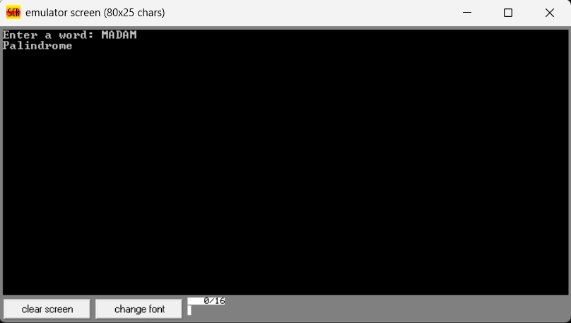

# 8086-Palindrome-Checker
A palindrome checker implemented using 8086 Assembly Language and tested in EMU8086 for the Computer Architecture End Semester Lab Project.
# 8086 Palindrome Checker

Computer Architecture End-of-Semester Lab Project (Topic 35).

## Aim
Check whether a word reads the same forwards and backwards using 8086 assembly language.

## Requirements
- EMU8086 emulator

## How it works
The program reads a word using DOS interrupt 21h. SI and DI point to opposite ends of the word. Each pair of characters is compared, and the pointers move inward until a mismatch is found or all pairs have been checked. The comparison is case-sensitive.

## How to run
1. Open `palindrome.asm` in EMU8086.
2. Compile the program and click Emulate.
3. Click Run, enter a word and press Enter.
4. Reload the program to test another word.

## Test cases
| Input | Expected output | Verification |
|---|---|---|
| MADAM | Palindrome | Observed in EMU8086 |
| HELLO | Not a palindrome | Not independently verified |
| LEVEL | Palindrome | Not independently verified |

## Execution screenshot

## Files
- `palindrome.asm`: Assembly source code.
- `output_madam.png`: Actual emulator output for MADAM.
